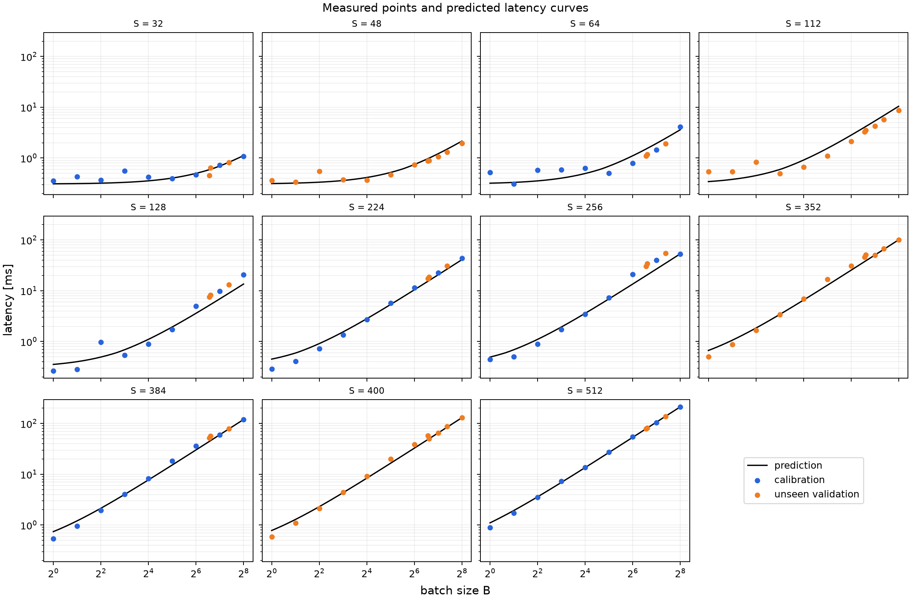
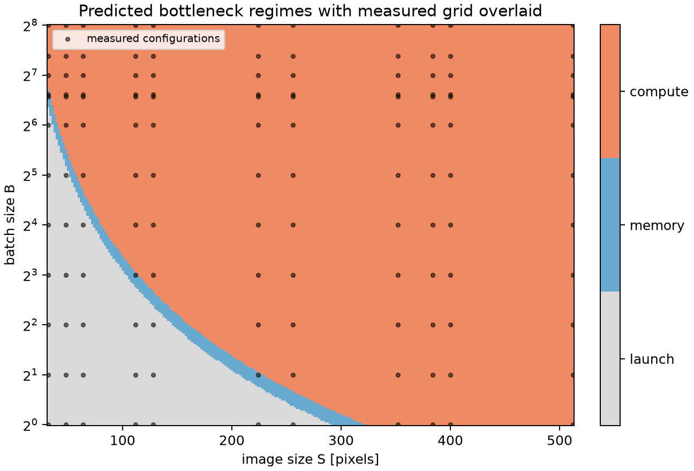

# Homework 1 — Analytical performance model of a small CNN

This directory is a complete, reproducible solution to `home_work_one.md`. It contains the exact model, vectorized analytical equations, all 132 required GPU measurements, fitted parameters, held-out validation, plots, tests, and a legible notebook-style derivation PDF.

## Result summary

The 63 points on the required base grid were used for calibration. All 69 configurations involving one of the randomly sampled coordinates were kept unseen until evaluation: `S = {48, 112, 352, 400}` and `B = {95, 98, 167}`.

| Quantity | Calibration MAPE | Unseen MAPE | Unseen R² | Main observation |
|---|---:|---:|---:|---|
| FLOPs | effectively 0% | 0.000% | 1.000 | Exact agreement with an independent layer/output-shape tally |
| Peak allocated memory | 57.91% | 58.81% | 0.703 | Parameter-free live-tensor model omits large cuDNN workspaces |
| Median latency | 18.48% | 17.27% | 0.982 | Roofline captures scale but misses algorithm-switch discontinuities |
| Whole-GPU energy | 12.14% | 13.76% | 0.976 | Compute energy plus active/background power explains most variation |

All 132 configurations ran successfully. The largest point, `S=512, B=256`, used 4,577,132,544 allocated bytes (4,365 MiB), took 212.22 ms, and consumed 30.43 J per pass. The ideal memory equation predicts 2,956,951,312 bytes (2,820 MiB), so it also predicts that the point fits in the GPU. Consequently, the measured and predicted OOM counts are both zero on this machine. The assignment asks that OOM be caught and recorded when it occurs; `measure.py` implements that path, but no result is artificially marked OOM.

## Hardware and software

- GPU: NVIDIA GeForce RTX 5060, 8,150 MiB, compute capability 12.0
- NVIDIA driver: 610.60; PyTorch CUDA build: 12.8
- OS: Windows 11 (WDDM)
- Python 3.12.14; PyTorch 2.11.0+cu128; cuDNN 9.19
- FP32 inference; `eval()` and `torch.inference_mode()`
- `torch.backends.cudnn.benchmark = False`
- cuDNN TF32 and matmul TF32 disabled
- Energy source: NVML whole-board total-energy counter for every point

The exact captured environment and grids are in [`results/environment.json`](results/environment.json).

## Network and equations

`models.py` implements the architecture in the assignment table. BatchNorm is not added because it is not present in that table. Convolutions use `bias=False`; linear layers retain their usual bias. There are 1,040,324 parameters.

With one MAC counted as two FLOPs and with ReLU/pooling/index operations excluded from the FLOP convention,

```text
FLOPs(S,B) = B (17,712 S² + 313,344).
```

For the parameter-free memory equation, model parameters stay live and the first convolution is the activation peak: its input (`3BS²` values) and output (`8BS²` values) coexist. All values are FP32:

```text
Memory(S,B) = 4,161,296 + 44 B S² bytes.
```

This is an ideal live-tensor equation. It deliberately excludes the CUDA context, reserved-but-free cache, allocation rounding, and cuDNN workspace, as required for a non-calibrated model. `torch.cuda.max_memory_allocated()` does include active workspaces. The measured/predicted memory ratio ranges from 1.55 at large shapes to 11.09 at tiny shapes (median 2.59), explaining the visible systematic offset.

Compulsory tensor traffic assumes that each logical operator reads inputs and weights once and writes its output once; in-place ReLU reads and writes its activation:

```text
Q(S,B) = 4 (91 B S² + 2,148 B + 1,040,324) bytes.
```

The calibrated launch-aware roofline is

```text
Latency(S,B,θ) = 17 L + max(FLOPs(S,B)/P, Q(S,B)/W),
```

where the 17 logical operations are six convolutions, seven ReLUs, MaxPool, global-average pool, and two linear layers. The fitted RTX 5060 parameters are `L = 16.189 µs/logical kernel`, `P = 5.601 TFLOP/s`, and `W = 127.743 GB/s`.

Whole-GPU energy includes idle/background energy rather than subtracting it:

```text
Energy(S,B,θE) = P_idle · Latency_hat + e_F · FLOPs + e_Q · Q.
```

The non-negative fit gives `P_idle = 57.461 W`, `e_F = 16.942 pJ/FLOP`, and an effectively zero `e_Q = 1.005 fJ/byte`. Here `P_idle` is an effective active/background coefficient, not the separately sampled desktop idle reading. Together with `e_F`, it implies roughly 152 W in the compute-dominated limit, consistent with the 145 W board power limit.

Every equation in `equations.py` accepts NumPy-broadcastable `image_size` and `batch` values.

## Measurement and calibration protocol

The grid is shuffled with a fixed seed to reduce temperature/order bias. Every shape is warmed up, then:

1. FLOPs are independently tallied with forward hooks from real Conv/Linear output shapes.
2. Peak allocated memory is read after `torch.cuda.reset_peak_memory_stats()` around one forward.
3. Individual forward latencies are measured with CUDA events; the median is stored.
4. An adaptive repeated-forward window of approximately one second is bracketed with NVML's monotonic whole-board energy counter and divided by the number of passes.
5. Any allocation or forward OOM is caught, written as `status=OOM`, cleaned up, and the sweep continues.

The raw and predicted values are in [`results/measurements.csv`](results/measurements.csv); fitted parameters and metrics are in [`results/theta.json`](results/theta.json).

## Discussion: where the equations break

The regime map classifies 26 measured configurations as launch-bound, four in the narrow memory-bound transition, and 102 as compute-bound. At small `BS²`, the fixed 17-launch term is larger than useful work. As `BS²` grows, constant weight traffic is amortized and arithmetic intensity rises. The fitted ridge point, `P/W ≈ 43.85 FLOP/byte`, is close to this network's large-work asymptote of about 48.66 FLOP/byte; this creates the observed memory strip before compute dominates.

The roofline is intentionally simple. “17 launches” counts framework-level logical operators, but cuDNN convolutions can launch multiple kernels. cuDNN also changes convolution algorithms at shape boundaries even with benchmark mode disabled. These effects explain local jumps such as the `S=256` validation batches, where latency/energy are underpredicted by roughly 35–39%. Cache reuse and workspace traffic mean compulsory `Q` is not literal DRAM traffic. The hard `max` also ignores overlap and the smooth transition between memory and compute limits.

Memory fails in a more diagnostic way: it is exact for the assumed liveness graph but not for the implementation. Large configurations settle near a 1.55× measured/predicted ratio, while fixed workspace costs dominate tiny inputs and make their ratios much larger. A calibrated workspace term would improve prediction, but doing that would violate the requirement that `Memory(S,B)` have no calibrated parameters.

Energy inherits latency error and adds sensor/board effects. NVML measures the entire GPU, including display/background activity, and its counter is temporally filtered. Repeated windows reduce quantization error but cannot make each pass independent. Despite that, unseen `R²=0.976` shows that the model captures scaling; the 13.76% MAPE is concentrated around the same shape-dependent kernel switches seen in latency.





## Reproduce

From this `hw1` directory, create an environment and install a CUDA build of PyTorch suitable for the machine. The commands used here were:

```powershell
uv venv ..\.venv --python 3.12
uv pip install --python ..\.venv\Scripts\python.exe torch --index-url https://download.pytorch.org/whl/cu128
uv pip install --python ..\.venv\Scripts\python.exe -r requirements.txt
..\.venv\Scripts\python.exe -m pytest -q
..\.venv\Scripts\python.exe measure.py --output results\measurements.csv --resume
..\.venv\Scripts\python.exe calibrate.py
..\.venv\Scripts\python.exe generate_derivations.py
```

On Linux, replace the interpreter path with `../.venv/bin/python`. `run_all.py` performs the last three pipeline steps. The full sweep takes several minutes on this GPU. `--resume` preserves completed rows, and `measure.py --help` lists quick/debug controls.

## Files

```text
hw1/
├── README.md
├── hw1_handwritten.pdf
├── models.py
├── equations.py
├── measure.py
├── calibrate.py
├── generate_derivations.py
├── run_all.py
├── requirements.txt
├── tests/test_hw1.py
└── results/
    ├── measurements.csv
    ├── theta.json
    ├── metrics.json
    ├── environment.json
    └── figures/*.png
```
